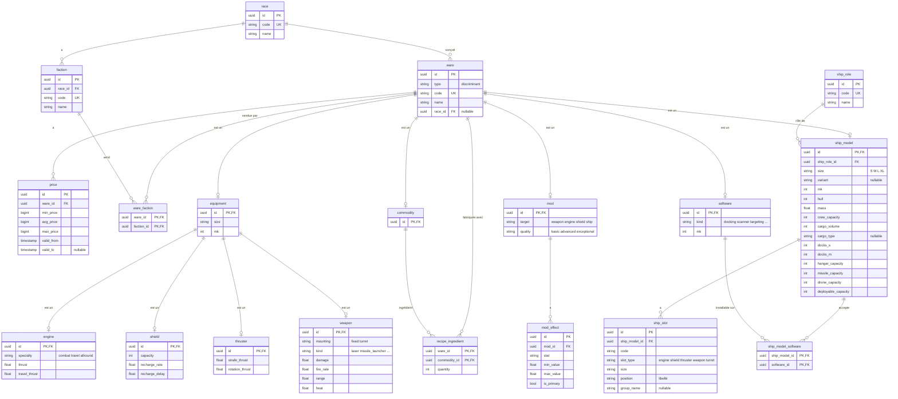

# Modèle de données — Référentiel

> Proposition de schéma pour le référentiel décrit dans [SPEC.md](SPEC.md).
> Tables PostgreSQL, mappées avec Doctrine ORM.

## 1. Idée centrale : tout ce qui se vend est une « ware »

Dans X4, vaisseaux, équipements, mods, logiciels et matériaux sont tous des
**wares** (`libraries/wares.xml`). Le schéma reprend ce principe : une table
`ware` commune, dont héritent les tables spécialisées.

Ce que la table commune apporte, une seule fois pour tout le catalogue :

- les **prix** historisés (`price`) ;
- la **disponibilité par faction** (`ware_faction`) ;
- les **recettes de fabrication** (`recipe_ingredient`) ;
- un identifiant unique, un code et un nom.

Sans ce parent commun, prix, disponibilité et recettes devraient pointer vers
cinq tables différentes (clé étrangère « polymorphe », sans intégrité en base).

Mapping Doctrine : **héritage par jointure** (`JOINED`). Chaque sous-type a sa
propre table avec ses colonnes typées, liée à `ware` par le même identifiant.

## 2. Diagramme



## 3. Tables

### Référence

| Table       | Rôle                                                              |
|-------------|-------------------------------------------------------------------|
| `race`      | Races du jeu de base                                              |
| `faction`   | Factions ; chacune appartient à une race                          |
| `ship_role` | Rôles de vaisseau (chasseur léger, destroyer…)                     |

La **taille** (`XS` à `XL`) n'est pas une table : c'est une énumération PHP
(fixée par le jeu), stockée en texte.

### Catalogue (`ware` et ses sous-types)

| Table         | Hérite de   | Contenu                                                  |
|---------------|-------------|----------------------------------------------------------|
| `ware`        | —           | Code, nom, race conceptrice, type (discriminant)         |
| `ship_model`  | `ware`      | Caractéristiques de coque, rôle, taille, variante, Mk    |
| `equipment`   | `ware`      | Taille et Mk communs à tous les équipements              |
| `engine`      | `equipment` | Spécialité, poussée                                      |
| `shield`      | `equipment` | Capacité, recharge                                       |
| `thruster`    | `equipment` | Manœuvrabilité                                           |
| `weapon`      | `equipment` | Arme fixe **ou** tourelle (`mounting`), dégâts, cadence… |
| `mod`         | `ware`      | Cible et qualité                                         |
| `software`    | `ware`      | Type de logiciel et Mk                                   |
| `commodity`   | `ware`      | Matériaux utilisés dans les recettes                     |

### Détails et liaisons

| Table                 | Rôle                                                         |
|-----------------------|--------------------------------------------------------------|
| `ship_slot`           | Emplacements d'un modèle : type, taille, position, groupe    |
| `mod_effect`          | Effets d'un mod : statistique, plage min / max, principal ou non |
| `ship_model_software` | Logiciels qu'un modèle peut recevoir                         |
| `ware_faction`        | Factions qui vendent une ware                                |
| `recipe_ingredient`   | Recette : matériaux et quantités pour fabriquer une ware     |
| `price`               | Prix historisés (voir ci-dessous)                            |

## 4. Choix détaillés

- **Tourelles et armes fixes dans la même table** (`weapon`, colonne
  `mounting`) : mêmes caractéristiques, seul le montage change. Règle de
  compatibilité : un emplacement `weapon` accepte une arme `fixed`, un
  emplacement `turret` une arme `turret`, de même taille.
- **Prix** : montants en `bigint` (crédits entiers, jamais de `float` pour de
  l'argent). Un nouveau prix ferme le précédent (`valid_to`). Une contrainte
  PostgreSQL d'exclusion empêche deux périodes qui se chevauchent pour une même
  ware ; le prix courant est celui dont la période contient la date du jour.
- **Identifiants** : UUID, comme l'entité `User` existante. Le `code` est un
  identifiant lisible et unique, par exemple `ship_arg_l_destroyer_01_a`
  (proche des identifiants du jeu).
- **Valeurs fixes en énumérations PHP** (taille, type d'emplacement, montage,
  qualité de mod…) plutôt qu'en tables : elles sont fixées par le jeu et le code
  en dépend.
- **Permissions** : aucune table, elles sont définies dans `security.yaml`.
- **Organisation du code** : un module `src/Catalog/` qui respecte le DDD
  simplifié du module `src/User/` (voir section 5).

## 5. Organisation du code : DDD simplifié

Le module `src/Catalog/` reprend exactement les conventions de `src/User/` :

```
src/Catalog/
├── Entity/          Entités Doctrine (Ware, ShipModel, Weapon, Price…) et énumérations
├── Repository/      Un dépôt par racine : save(), get() qui lève une exception métier
├── Service/         Cas d'usage partagés entre l'API et la console
├── Exception/       Exceptions métier (ShipModelNotFound, PriceOverlap…)
├── Api/
│   ├── Resource/    Représentations HTTP (DTO) avec #[ApiResource] et fromEntity()
│   ├── Input/       DTO d'entrée validés (CreateShipModelInput…)
│   └── State/       Providers (lecture) et Processors (écriture)
└── Console/         Commandes app:catalog:* si besoin
```

Règles reprises de `User` :

- **Les entités ne sont jamais exposées directement** : l'API passe par des
  ressources (`ShipModelResource::fromEntity()`), comme `UserResource`.
- **Entités riches** : propriétés privées, constructeurs nommés
  (`ShipModel::create(...)`) et méthodes métier (`addSlot()`,
  `changePrice()`…) qui protègent les règles du domaine, plutôt que des setters.
- **Cas d'usage dans `Service/`** quand ils sont partagés ou portent une règle
  qui dépasse une entité (ex. : fermer le prix courant et ouvrir le nouveau).
- **Écriture via Processors**, qui reçoivent un DTO `Input` et appellent le
  service ou l'entité.
- **Exceptions métier** déclarées dans `exception_to_status` d'API Platform
  (404, 409…).
- **Sécurité dans les opérations** `#[ApiResource]`, mais avec des permissions
  (`is_granted('PERM_SHIP_MODEL_WRITE')`) au lieu de rôles.

Configuration à ajouter : mapping Doctrine `Catalog` dans
`config/packages/doctrine.yaml` et chemin `src/Catalog/Api/Resource` dans
`config/packages/api_platform.yaml`, comme pour `User`.

Pour les sous-types (`Engine`, `Weapon`…), les ressources d'API restent par
type (`/api/engines`, `/api/weapons`…), chacune avec ses champs spécifiques.

## 6. Points à valider

1. **Héritage `JOINED`** : lire un équipement demande une jointure par niveau
   (`ware` → `equipment` → `engine`). Acceptable pour un catalogue, mais à
   garder en tête pour les listes volumineuses (Elasticsearch peut prendre le
   relais pour la recherche).
2. **`commodity`** : les matériaux des recettes (pièces de coque, claytronique…)
   sont-ils dans le périmètre, ou les recettes peuvent-elles attendre ?
3. **Caractéristiques des équipements** : les colonnes proposées pour `engine`,
   `shield`, `thruster` et `weapon` sont un premier jet à compléter avec les
   valeurs du jeu.
4. **Prix par faction** : si un prix peut dépendre de la faction vendeuse,
   ajouter un `faction_id` (nullable) dans `price`.
